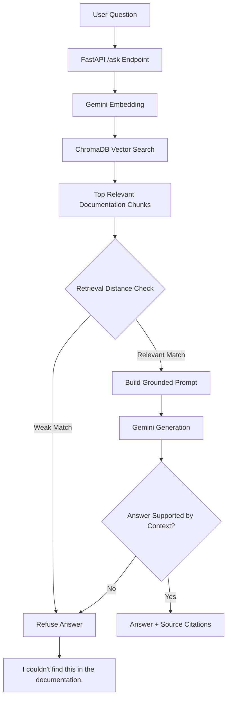

# SupportBot

**SupportBot** is a Retrieval-Augmented Generation (RAG) customer support assistant built for the fictional note-taking application **NoteNest**.

It retrieves relevant information from product documentation, generates grounded answers using Google Gemini, provides source citations, and refuses unsupported questions instead of hallucinating.

## Live Demo

**Live Application:** https://supportbot-h32t.onrender.com/

**GitHub Repository:** https://github.com/GopalRanjan32/SupportBot

> Note: The application is hosted on a free Render instance, so the first request after inactivity may take some time while the service wakes up.

---

## Features

- Retrieval-Augmented Generation (RAG)
- Google Gemini embeddings and generation
- ChromaDB vector search
- Markdown document ingestion and chunking
- Source file and chunk citations
- Two-layer hallucination/refusal control
- FastAPI REST API
- HTML, CSS, and vanilla JavaScript chat interface
- Automated evaluation pipeline
- pytest automated tests
- Docker containerization
- GitHub Actions CI
- Render cloud deployment

---

## Tech Stack

### Backend
- Python 3.13
- FastAPI
- Uvicorn

### AI / RAG
- Google Gemini API
- `google-genai`
- Gemini embeddings
- ChromaDB

### Frontend
- HTML
- CSS
- Vanilla JavaScript

### Quality & Deployment
- pytest
- Docker
- GitHub Actions
- Render

---

## Architecture



---

## RAG Pipeline

### 1. Document Ingestion

NoteNest documentation is stored as fictional Markdown help files covering:

- Billing
- Subscription cancellation
- Login and password recovery
- Synchronization
- Exporting
- Sharing
- Security
- Account deletion
- Storage
- Search

The application loads these files and splits them into smaller semantic sections.

### 2. Embeddings

Each documentation chunk is converted into a Gemini embedding.

The project uses 768-dimensional embedding vectors.

### 3. Vector Storage

The embeddings, original text, and metadata are stored in ChromaDB.

Metadata includes:

- Source filename
- Chunk number

The vector index is automatically rebuilt from the documentation when the application starts.

### 4. Retrieval

When a user asks a question:

1. The question is converted into an embedding.
2. ChromaDB finds the nearest documentation chunks.
3. The top retrieved chunks are passed to the generation stage.

### 5. Grounded Generation

Gemini receives only the retrieved NoteNest documentation as context.

The prompt explicitly prevents the model from inventing NoteNest features, policies, pricing, or procedures.

### 6. Citations

Citations are generated from retrieval metadata rather than generated by the LLM.

Example:

```text
billing.md - chunk 4
```

This prevents the model from inventing source filenames.

---

## Hallucination Control

SupportBot uses a two-layer refusal mechanism.

### Layer 1 — Retrieval Distance Threshold

If the closest ChromaDB result is not sufficiently similar to the user's question, the system refuses immediately without generating an answer.

### Layer 2 — LLM Context Check

Some unsupported questions can still be semantically close to real documentation.

For example:

```text
Does NoteNest support cryptocurrency trading?
```

may retrieve billing-related chunks even though the documentation does not contain an answer.

In this case, Gemini is instructed to determine whether the retrieved context actually supports the answer.

If not, SupportBot responds:

```text
I couldn't find this in the documentation.
```

No citations are shown for refused questions.

---

## Example

### Supported Question

**Question**

```text
What happens if my Pro payment fails?
```

**Answer**

```text
If a Pro subscription payment fails, NoteNest retries the payment for
7 days. During this period, the user can continue using Pro features.
If payment is still unsuccessful after 7 days, the account is moved
to the Free Plan.
```

**Source**

```text
billing.md - chunk 4
```

### Unsupported Question

**Question**

```text
What is the weather in Delhi today?
```

**Response**

```text
I couldn't find this in the documentation.
```

---

## Evaluation

SupportBot was evaluated using a custom dataset of **25 questions**:

- 20 answerable NoteNest questions
- 5 intentionally out-of-scope questions

### Results

| Metric | Result |
|---|---:|
| Answer accuracy | 25/25 (100%) |
| Citation accuracy | 25/25 (100%) |
| Refusal accuracy | 25/25 (100%) |

These results are based on a small controlled internal evaluation dataset and should not be interpreted as universal real-world accuracy.

### Evaluation Metrics

**Answer Accuracy**

Measures whether the system correctly answers answerable questions and refuses expected out-of-scope questions.

**Citation Accuracy**

Checks whether the expected documentation source appears in the returned citations.

**Refusal Accuracy**

Checks whether the system correctly distinguishes answerable and unsupported questions.

---

## Automated Testing

The project includes pytest tests covering:

- Retrieval distance refusal
- Valid retrieval acceptance
- Missing chunk behavior
- LLM refusal detection
- FastAPI health endpoint
- `/ask` endpoint response
- Request validation

Current test result:

```text
8 passed
```

---

## Continuous Integration

GitHub Actions automatically runs the test suite whenever code is pushed to the `main` branch or a pull request is opened.

CI pipeline:

```text
Push / Pull Request
        |
        v
GitHub Actions
        |
        v
Install Python Dependencies
        |
        v
Run pytest
        |
        v
Pass / Fail
```

---

## Docker

The project is containerized using Docker.

Build the image:

```bash
docker build -t supportbot .
```

Run locally:

```bash
docker run --rm -p 8000:8000 --env-file .env supportbot
```

The container automatically builds the NoteNest ChromaDB vector index during application startup.

---

## Local Setup

### 1. Clone the repository

```bash
git clone https://github.com/GopalRanjan32/SupportBot.git
cd SupportBot
```

### 2. Create a virtual environment

Windows:

```bash
python -m venv .venv
.venv\Scripts\activate
```

### 3. Install dependencies

```bash
pip install -r requirements.txt
```

### 4. Create `.env`

```env
GEMINI_API_KEY=your_gemini_api_key
```

### 5. Start the application

```bash
uvicorn app.main:app --reload
```

Open:

```text
http://127.0.0.1:8000
```

FastAPI Swagger documentation:

```text
http://127.0.0.1:8000/docs
```

---

## Project Structure

```text
SupportBot/
|
|-- app/
|   |-- ingest.py
|   |-- main.py
|   |-- rag.py
|   |-- test_embedding.py
|   |-- test_rag_terminal.py
|   `-- test_retrieval.py
|
|-- docs/
|   `-- NoteNest Markdown documentation
|
|-- eval/
|   |-- eval_dataset.json
|   |-- eval_results.json
|   `-- run_eval.py
|
|-- static/
|   |-- index.html
|   |-- style.css
|   `-- script.js
|
|-- tests/
|   |-- test_api.py
|   `-- test_rag.py
|
|-- .github/
|   `-- workflows/
|       `-- ci.yml
|
|-- Dockerfile
|-- requirements.txt
|-- pytest.ini
`-- README.md
```

---

## Key Engineering Decisions

- Used direct Gemini and ChromaDB integrations instead of LangChain to keep the RAG pipeline transparent and explainable.
- Stored citation metadata directly in ChromaDB rather than asking the LLM to generate citations.
- Added two-layer refusal logic to reduce hallucinations.
- Rebuild the vector index during application startup to make Docker and cloud deployment reproducible.
- Mocked external AI calls in automated tests to avoid API-dependent and flaky CI tests.

---

## Disclaimer

NoteNest is a fictional product created specifically for this project. All documentation used by SupportBot was created for demonstration and evaluation purposes.
